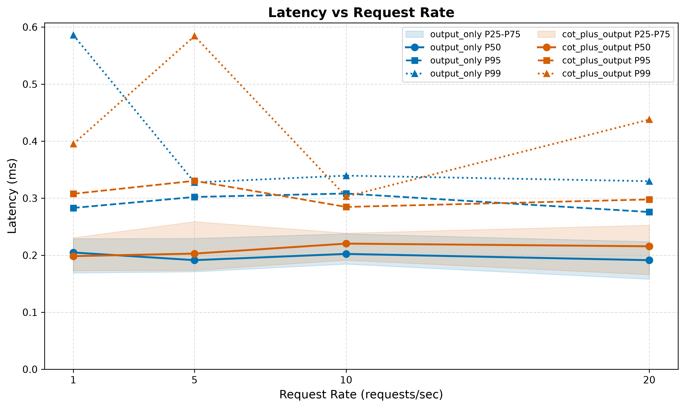
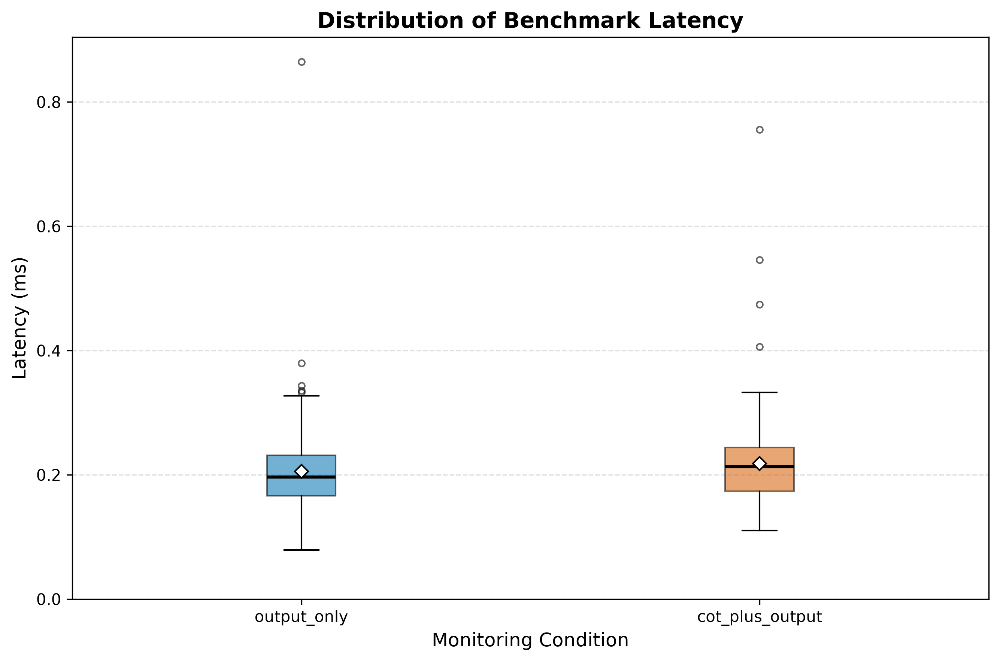

# Monitoring LLM Reasoning Traces for Unsafe Behavior

**Does reading the chain-of-thought (CoT) help an automated monitor detect unsafe LLM behavior compared with reading outputs alone?**


**Authors:** Yerzhankyzy Markhaba, Kulmakhanbet Zarina

**Course:** Research Methods — Task 3

**Project:** Monitoring LLM Reasoning Traces for Unsafe Behavior

---

## 1. Overview

This project investigates whether providing an automated monitor with access to a language model's Chain-of-Thought (CoT) reasoning trace improves the detection of unsafe behavior compared with monitoring the final output alone.

Two monitoring conditions are compared using identical evaluation episodes:

| Condition | Information available to the monitor |
|---|---|
| `output_only` | Prompt and final output |
| `cot_plus_output` | Prompt, reasoning trace, and final output |

Unsafe behavior is divided into four categories:

- Reward hacking
- Deception
- Sabotage
- Harmful compliance

The primary research objective is to evaluate detection quality at a target false positive rate (FPR) of 5%.

The project also evaluates computational performance through latency measurements under different request-rate workloads.

## 2. Research Questions and Evaluation Metrics

| Research Question | Description | Statistical Method |
|---|---|---|
| RQ1 | Does recall differ between unsafe-behavior categories? | Chi-square homogeneity test; Fisher–Freeman–Halton Monte Carlo test if expected counts are small |
| RQ2 | Is the recall of the CoT + Output monitor at 5% FPR greater than 0.70? | One-sided exact binomial test and Wilson 95% confidence interval |
| RQ3 | Does the CoT + Output monitor achieve higher recall than the Output-only monitor? | One-sided exact McNemar test and paired percentile bootstrap 95% confidence interval |

The intended detection metrics are:

- Recall at 5% FPR — primary metric.
- Precision.
- F1-score.
- AUROC.

Computational performance metrics include:

- Mean latency.
- Standard deviation.
- Median latency (P50).
- P95 and P99 latency.
- Throughput (requests per second).
- Bootstrap 95% confidence intervals.
- IQR-based outlier counts.

## 3. Experimental Methodology

### 3.1 Data Collection — SS7

The data collection component records benchmark measurements in JSONL format.

The collection process includes:

1. Loading experimental episodes.
2. Running a warm-up phase.
3. Running repeated benchmark measurements.
4. Evaluating both monitoring conditions.
5. Recording latency, monitor score, status, and error information.
6. Saving measurement records to `data/raw/`.

The benchmark configuration uses:

| Parameter | Value |
|---|---:|
| Warm-up repeats | 1 |
| Benchmark repeats | 5 |
| Episodes | 10 |
| Monitoring conditions | 2 |
| Target request rates | 1, 5, 10, 20 RPS |
| Measurements per condition and request rate | 50 |
| Expected benchmark measurements | 400 |

The collection script is located at `src/collect_data.py`.

### 3.2 Data Processing and Statistical Analysis — SS8

Raw JSONL measurements are processed using Python and NumPy.

The processing pipeline performs:

- JSONL parsing and validation.
- Warm-up record exclusion.
- Separation of successful and failed measurements.
- Error counting as a separate guardrail metric.
- Latency validation.
- Descriptive statistical calculations.
- Bootstrap confidence interval estimation.
- Non-destructive outlier detection using the 1.5 × IQR rule.
- Export of aggregated statistics to CSV.

Outliers are flagged rather than automatically removed. This preserves potentially meaningful performance spikes.

The main processing script is:

`src/process_data.py`

The aggregated results are stored in:

`data/processed/metrics_summary.csv`

### 3.3 Statistical Formulas

Mean latency:

\[
\overline{L}=\frac{1}{N}\sum_{i=1}^{N}L_i
\]

Standard deviation:

\[
SD=\sqrt{\frac{1}{N-1}\sum_{i=1}^{N}(L_i-\overline{L})^2}
\]

Interquartile range:

\[
IQR=Q_3-Q_1
\]

Outlier boundaries:

\[
Lower=Q_1-1.5IQR
\]

\[
Upper=Q_3+1.5IQR
\]

Throughput:

\[
R_{\text{achieved}}=\frac{N}{T}
\]

where \(N\) is the number of completed requests and \(T\) is the measurement duration in seconds.

The mean latency uncertainty is estimated using percentile bootstrap confidence intervals with 2,000 resamples and a fixed random seed.

## 4. Experimental Results and Discussion

### 4.1 Benchmark Summary

The benchmark produced 400 successful measurements across two monitoring conditions and four target request rates.

| Measurement | Result |
|---|---:|
| Total benchmark measurements | 400 |
| Measurements per condition and request rate | 50 |
| Target request rates | 1, 5, 10, 20 RPS |
| Failed measurements | 0 |
| Warm-up repeats | 1 |

### 4.2 Latency Results

The following table presents mean latency, bootstrap confidence intervals, and upper latency percentiles.

| Target RPS | Condition | Mean (ms) | 95% Bootstrap CI (ms) | P95 (ms) | P99 (ms) |
|---:|---|---:|---:|---:|---:|
| 1 | output_only | 0.2158 | 0.1926–0.2495 | 0.2829 | 0.5860 |
| 1 | cot_plus_output | 0.2114 | 0.1957–0.2275 | 0.3077 | 0.3950 |
| 5 | output_only | 0.2023 | 0.1891–0.2170 | 0.3021 | 0.3276 |
| 5 | cot_plus_output | 0.2298 | 0.2062–0.2586 | 0.3304 | 0.5843 |
| 10 | output_only | 0.2099 | 0.1969–0.2239 | 0.3082 | 0.3395 |
| 10 | cot_plus_output | 0.2182 | 0.2074–0.2294 | 0.2846 | 0.3029 |
| 20 | output_only | 0.1943 | 0.1801–0.2090 | 0.2758 | 0.3298 |
| 20 | cot_plus_output | 0.2139 | 0.1952–0.2357 | 0.2978 | 0.4379 |

### 4.3 Results Discussion

The observed mean latency ranged from approximately 0.194 ms to 0.230 ms across the tested conditions and request rates.

The `output_only` condition demonstrated lower mean latency at 5, 10, and 20 RPS. At 1 RPS, the `cot_plus_output` condition demonstrated slightly lower mean latency.

The 95% bootstrap confidence intervals overlap across all four request-rate comparisons. Therefore, the observed differences should be interpreted descriptively. They do not independently establish statistically significant differences between the monitoring conditions.

The upper latency percentiles show that occasional measurements were substantially slower than the median. The highest observed P99 values were 0.5860 ms for `output_only` at 1 RPS and 0.5843 ms for `cot_plus_output` at 5 RPS.

These results describe computational performance only. They do not demonstrate that either monitoring condition has better unsafe-behavior detection quality.

### 4.4 Limitations

The current benchmark uses a keyword-based monitoring backend and a small demonstration dataset of 10 episodes.

Consequently:

- The measurements characterize the current local keyword implementation.
- The benchmark does not establish production-scale LLM monitoring performance.
- Latency results cannot establish detection effectiveness.
- Classification metrics require a separate evaluation of monitor predictions against ground-truth labels.
- Larger datasets and a finalized LLM-based monitor are needed for stronger research conclusions.

## 5. Scientific Visualizations

Two scientific figures are generated to communicate the experimental results.

### Figure 1. Latency vs. Request Rate



The figure compares P50, P95, and P99 latency across four target request rates for both monitoring conditions. The shaded areas represent the interquartile range (P25–P75).

### Figure 2. Distribution of Benchmark Latency



The boxplot compares latency distributions between `output_only` and `cot_plus_output`, displaying medians, quartiles, and potential outliers.

Both figures are exported in PDF and PNG formats. PNG figures use 300 DPI for high-resolution presentation.

Figure files are located in `reports/figures/`.

## 6. ML Domain Model — SS9

The mathematical formulation of the monitoring task is documented in:

[`docs/domain_model.md`](docs/domain_model.md)

The domain model includes:

- Binary classification problem formulation.
- Binary Cross-Entropy loss.
- Mean Squared Error and Mean Absolute Error.
- Focal Loss for class imbalance.
- Classification threshold and decision rule.
- False Positive Rate and Recall constraints.
- Precision, Recall, F1-score, ROC-AUC, and PR-AUC.
- Latency and throughput equations.
- Mathematical notation table.
- Experimental scope and limitations.

The current keyword-based backend does not train a neural classifier or optimize Cross-Entropy or Focal Loss. These equations describe the formal ML problem and possible future approaches.

## 7. Repository Structure

```text
cot-monitor-benchmark/
│
├── configs/
│   ├── config.yaml
│   └── monitor_prompt.txt
│
├── data/
│   ├── sample/
│   │   └── episodes.jsonl
│   ├── raw/
│   │   ├── test_run.jsonl
│   │   └── test_run_load.jsonl
│   └── processed/
│       ├── metrics_summary.csv
│       └── metrics_summary_notebook.csv
│
├── docs/
│   ├── methodology_card.md
│   ├── methodology_card_v3.pdf
│   └── domain_model.md
│
├── notebooks/
│   ├── 01_data_analysis.ipynb
│   └── research_analysis.ipynb
│
├── reports/
│   └── figures/
│       ├── fig1_latency_vs_load.pdf
│       ├── fig1_latency_vs_load.png
│       ├── fig2_distribution_boxplot.pdf
│       └── fig2_distribution_boxplot.png
│
├── results/
│   ├── sample_run.json
│   └── sample_run.log
│
├── src/
│   ├── collect_data.py
│   ├── process_data.py
│   ├── visualize.py
│   ├── benchmark.py
│   ├── monitors.py
│   ├── metrics.py
│   ├── stats.py
│   └── main.py
│
├── tests/
│
├── .gitignore
├── Dockerfile
├── LICENSE
├── README.md
└── requirements.txt
```

## 8. Installation and Reproducibility

### 8.1 System Requirements

- Python 3.13.
- pip.
- Jupyter Notebook support.
- Required Python packages listed in `requirements.txt`.
- No GPU is required for the default keyword-based benchmark.

### 8.2 Install Dependencies

Run from the repository root:

```bash
pip install -r requirements.txt
```

### 8.3 Run Data Collection

```bash
python -m src.collect_data --config configs/config.yaml --output data/raw/test_run_load.jsonl
```

### 8.4 Run Data Processing

```bash
python -m src.process_data --config configs/config.yaml --input data/raw/test_run_load.jsonl --output data/processed/metrics_summary.csv
```

### 8.5 Generate Scientific Figures

```bash
python -m src.visualize
```

### 8.6 Run the Analysis Notebook

Open:

`notebooks/01_data_analysis.ipynb`

Execute all notebook cells from top to bottom to reproduce the data loading, filtering, statistical analysis, confidence intervals, outlier analysis, and visualizations.

The experiment uses a fixed random seed of 42 for reproducibility.

## 9. Configuration

The main experiment configuration is stored in:

`configs/config.yaml`

Important parameters include:

| Parameter | Value |
|---|---|
| Experiment seed | 42 |
| Target FPR | 0.05 |
| Working target recall | 0.70 |
| Bootstrap resamples | 2,000 |
| Warm-up repeats | 1 |
| Benchmark repeats | 5 |
| Target request rates | 1, 5, 10, 20 RPS |
| Monitor backend | keyword |

The `keyword` backend is an offline placeholder. The configuration also contains settings for a future LLM-based monitor.

## 10. Git Hygiene

The repository uses `.gitignore` to exclude temporary and environment-specific files, including:

- Python cache files.
- Virtual environments.
- Jupyter checkpoints.
- Temporary operating-system files.

The repository retains the scripts, notebooks, configuration, aggregated results, and figures required to reproduce and understand the experiment.

Sensitive API keys and credentials must never be committed.

## 11. Conclusion

Task 3 extends the research repository with an experimental data collection pipeline, statistical data processing, scientific visualizations, and an ML domain model.

The benchmark provides a reproducible comparison of latency distributions for the two monitoring conditions at four target request rates.

The results show differences in observed latency, but the current experiment does not establish whether access to Chain-of-Thought improves unsafe-behavior detection. That research question requires a finalized monitoring model and a larger labeled evaluation dataset.

## 12. License and Citation

This project is released under the MIT License. See [`LICENSE`](LICENSE).

### BibTeX

```bibtex
@misc{yerzhankyzy2026cotmonitor,
  author = {Yerzhankyzy, Markhaba and Kulmakhanbet, Zarina},
  title = {Monitoring LLM Reasoning Traces for Unsafe Behavior:
           A CoT vs Output-Only Monitor Benchmark},
  year = {2026},
  note = {Research Methods, Task 3},
  howpublished = {GitHub repository}
}